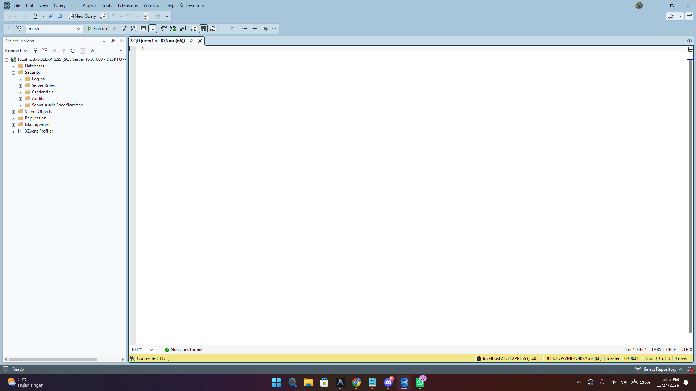
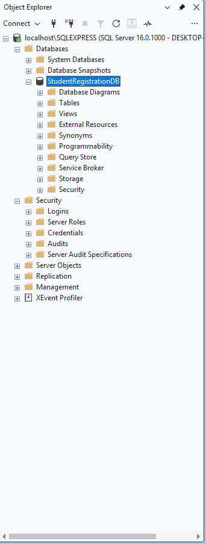
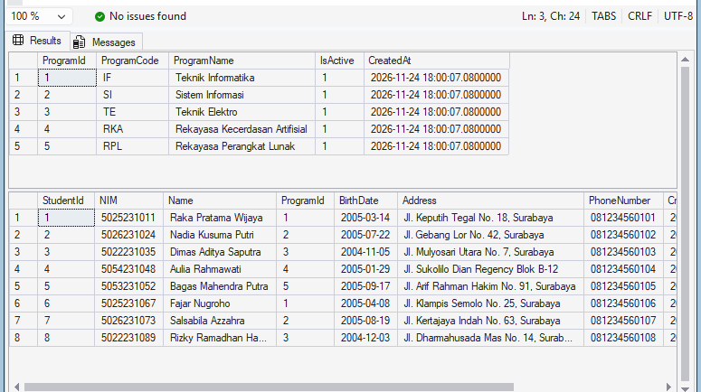
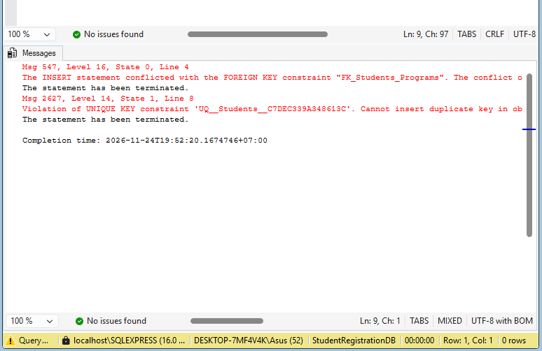
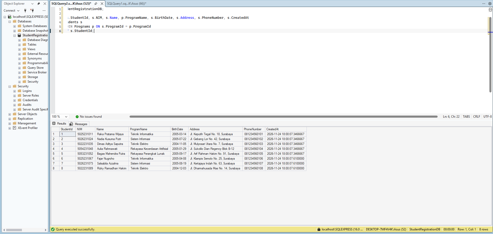
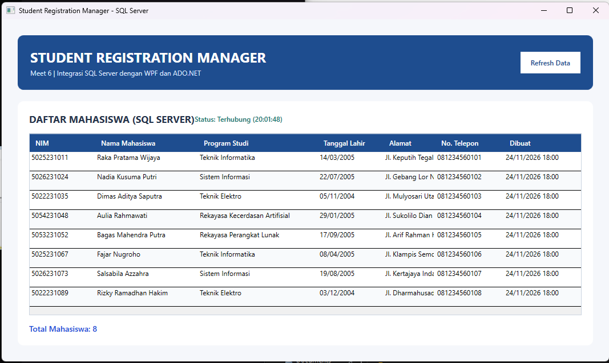

# Meet 6 - Student Registration Manager dengan SQL Server dan WPF

**Nama**  : Leyan Harits R W  
**NRP**   : 5025231288

Meet 6 melanjutkan aplikasi **Student Registration Manager** dari Meet 5 dengan memindahkan penyimpanan data dari memory ke **SQL Server** menggunakan **ADO.NET (`Microsoft.Data.SqlClient`)**. Praktikum ini terbagi menjadi dua bagian utama: **Hands-On Lab 1** untuk perancangan dan pengujian database di SQL Server Management Studio (SSMS), serta **Hands-On Lab 2** untuk integrasi aplikasi desktop WPF dengan database tersebut.

## Fokus Meet 6

1. **Hands-On Lab 1 (SQL Server & SSMS):**
   - Membuat database `StudentRegistrationDB` di instance `localhost\SQLEXPRESS`.
   - Merancang dua tabel berelasi **1:N** (`Programs` dan `Students`) dengan `PRIMARY KEY`, `FOREIGN KEY`, `UNIQUE`, dan nilai `DEFAULT`.
   - Mengisi 5 program studi dan 5 data mahasiswa awal, lalu menambah 3 mahasiswa baru sehingga total menjadi 8 data mahasiswa.
   - Menguji integritas data menggunakan *constraint* `FOREIGN KEY` (`ProgramId` tidak valid) dan `UNIQUE` (`NIM` duplikat).
   - Menjalankan query latihan (`INNER JOIN`, `WHERE`, `COUNT`, dan `GROUP BY`).
2. **Hands-On Lab 2 (WPF & ADO.NET):**
   - Menggunakan paket NuGet `Microsoft.Data.SqlClient` untuk koneksi ke SQL Server.
   - Membaca data hasil `INNER JOIN` dari database menggunakan `SqlConnection`, `SqlCommand`, dan `SqlDataReader`.
   - Menampilkan data ke `DataGrid` lengkap dengan tombol **Refresh Data**, status koneksi, dan penanganan error (`try-catch`).
   - Menyelesaikan **Mini Challenge** dengan menampilkan kolom **Alamat** dan **Dibuat**, serta menghitung total mahasiswa langsung dari database menggunakan `SELECT COUNT(*)`.

Alur data aplikasi:

```text
SQL Server (StudentRegistrationDB)
    |  INNER JOIN Programs & Students + SELECT COUNT(*)
    v
MahasiswaRepository (ADO.NET / Microsoft.Data.SqlClient)
    |  SqlConnection -> SqlCommand -> SqlDataReader
    v
Models (Mahasiswa & ProgramStudi)
    |  List<Mahasiswa> & total count
    v
MainWindow.xaml (DataGrid, Refresh Data, Status & Total)
```

## Struktur Database

Database `StudentRegistrationDB` memiliki dua tabel yang berelasi satu ke banyak (`1:N`):

- **`Programs`**: menyimpan master program studi (`ProgramId` PK, `ProgramCode` UNIQUE, `ProgramName`, `IsActive`, `CreatedAt`).
- **`Students`**: menyimpan data mahasiswa (`StudentId` PK, `NIM` UNIQUE, `Name`, `ProgramId` FK ke `Programs`, `BirthDate`, `Address`, `PhoneNumber`, `CreatedAt`, `UpdatedAt`).

## Struktur Project

```text
Meet 6/
├── README.md
├── Database/
│   └── StudentRegistrationDB.sql
├── Images/
│   ├── 1.png
│   ├── 2.png
│   ├── 3.png
│   ├── 4.png
│   ├── 5.png
│   └── 6.png
└── StudentRegistrationApp/
    ├── App.xaml
    ├── App.xaml.cs
    ├── MainWindow.xaml
    ├── MainWindow.xaml.cs
    ├── Data/
    │   └── MahasiswaRepository.cs
    ├── Models/
    │   ├── Mahasiswa.cs
    │   └── ProgramStudi.cs
    └── StudentRegistrationApp.csproj
```

## Cara Menjalankan

1. Jalankan script `Database/StudentRegistrationDB.sql` di SSMS pada instance `localhost\SQLEXPRESS`.
2. Jalankan aplikasi WPF melalui terminal:
   ```powershell
   dotnet run --project "Meet 6\StudentRegistrationApp\StudentRegistrationApp.csproj"
   ```

## Dokumentasi Uji Coba

### 1. Koneksi SQL Server Berhasil di SSMS



### 2. Database `StudentRegistrationDB` pada Object Explorer



### 3. Isi Tabel `Programs` dan Tabel `Students`



### 4. Pengujian Constraint (`FOREIGN KEY` dan `UNIQUE`)



### 5. Hasil Query `INNER JOIN` (8 Data Mahasiswa)



### 6. Aplikasi WPF Menampilkan Data dari SQL Server


